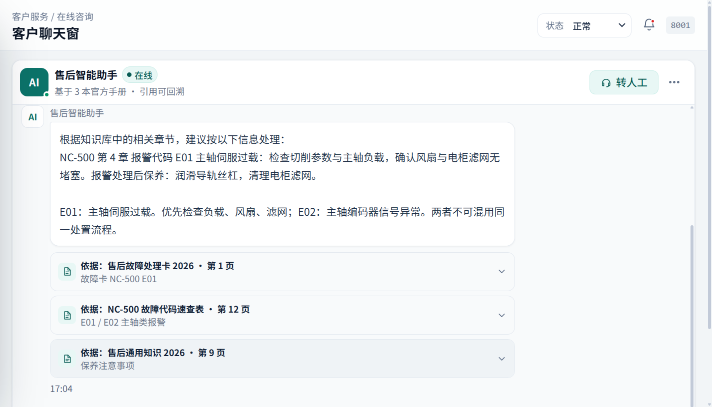
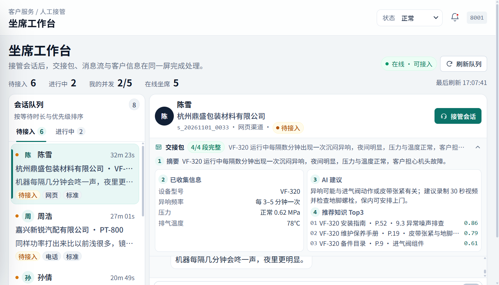
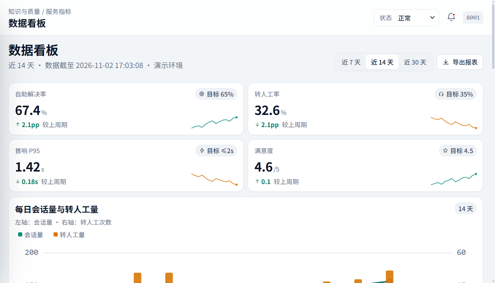
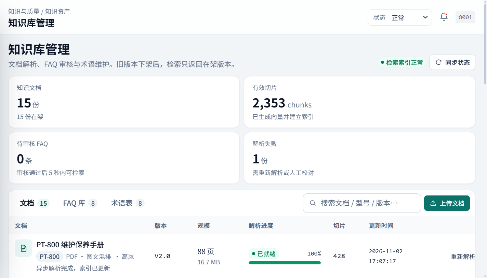
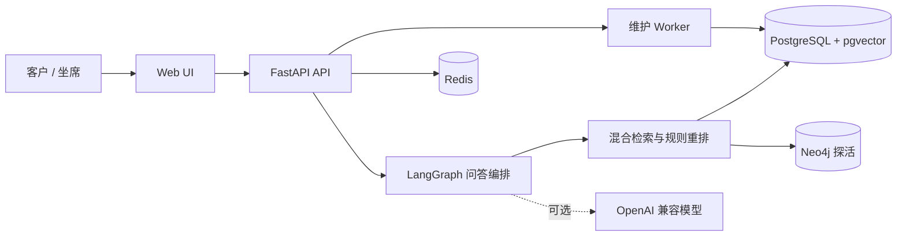

# 设备售后知识问答系统

> 面向工业设备售后场景的可部署知识问答与转人工闭环：回答必须带手册出处，答不准自动转人工，支持多租户、审计、限流与 Docker Compose 部署。


## 项目定位

工业设备售后资料通常分散在操作手册、FAQ、历史工单和内部知识卡中。客户用“趴窝、报错、跳闸”这类口语描述问题时，关键词检索经常答偏；转人工时，坐席还要重新确认设备型号、故障现象和已尝试操作。

本项目把这些环节串成一个可本地部署的闭环：

- 客户发起问题，系统优先返回带文档、页码、章节引用的处理建议。
- 置信度低、金额/责任敏感、图片消息或多轮未解决时，自动生成交接包转人工。
- 交接包包含会话摘要、已收集信息、AI 建议和推荐知识 Top3。
- 系统支持多租户、审计、限流、幂等、并发接管和异常降级。
- 通过 Docker Compose 交付 app、worker、PostgreSQL、Redis、Neo4j 五个服务。

> 当前状态：**本机可部署版本已通过回归与异常场景验证**。真实大模型、OCR、Neo4j 图谱写入和生产服务器验收仍在路线图中，详见[架构文档](docs/ARCHITECTURE.md)与[评测说明](docs/EVALUATION.md)。

## 界面预览

<p align="center">
  
  
</p>

<p align="center">
  
  
</p>

完整截图与说明见[截图目录](docs/SCREENSHOTS.md)。截图使用构造演示数据，不代表真实客户数据。

## 核心能力

| 能力 | 实现 |
|---|---|
| 问答编排 | LangGraph 状态图：`intent` → `retrieve` → `guard` → `generate` → `verify` |
| 检索 | 型号规范化、口语术语扩展、FAQ 精确匹配、BM25、384 维哈希向量、规则重排 |
| 引用 | 回答返回文档名、页码、章节和证据摘要 |
| 转人工 | 低置信度、敏感金额/责任、客户要求、图片消息、多轮未解决时转人工 |
| 交接包 | 摘要、已收集信息、AI 建议、推荐知识 Top3、转人工原因 |
| 多租户 | 业务表带 `tenant_id`，管理接口按角色二次校验 |
| 稳定性 | 健康检查、Redis 幂等、限流、单坐席 5 并发、重复接管 409、Redis 宕机降级、30 分钟归档 |
| 部署 | Docker Compose 五服务；本机端口固定 `8001`，生产配置独立 |

## 系统架构



更完整的容器拓扑、请求时序、数据模型和设计取舍见[架构文档](docs/ARCHITECTURE.md)。

## 技术栈

| 层级 | 实际使用 |
|---|---|
| 后端 | Python 3.11、FastAPI、Gunicorn、SQLAlchemy、Pydantic |
| 问答编排 | LangGraph 状态图：intent -> retrieve -> guard -> generate -> verify |
| 检索 | FAQ 精确匹配、BM25、384 维哈希向量、型号规范化、口语术语扩展、规则重排 |
| 数据层 | PostgreSQL 15 + pgvector、Redis 6、Neo4j 5.26（当前仅接入与健康检查） |
| 前端 | 原生 HTML、CSS、JavaScript，无前端构建步骤 |
| 部署 | Docker、Docker Compose 五服务：app、worker、db、redis、neo4j |
| 质量验证 | pytest 29 passed、120/120 构造回归、DoD 18/18、极端场景 19 PASS / 0 FAIL / 2 N/A |

未接入项：bge-reranker、RAGAS、Langfuse、OCR/视觉模型、Neo4j 图谱写入与多跳查询。以上技术栈按当前代码和实际运行结果列出，不把后续规划写成已实现能力。

## 快速开始

### 环境要求

- Windows / macOS / Linux
- Docker Desktop（含 Docker Compose v2）
- 端口 `8001` 可用

### 启动

```powershell
Copy-Item .env.example .env
docker build -t kb-app:dev .
docker build -t kb-pgvector:pg15 docker/db
docker compose -p kb up -d --no-build
Invoke-WebRequest http://127.0.0.1:8001/health -UseBasicParsing
```

首次启动会自动建表并导入构造演示数据。演示环境使用自动登录，管理员账号见 `.env.example`；生产环境请关闭 `DEMO_MODE` 并更换默认密码。

### 健康检查

```powershell
Invoke-RestMethod http://127.0.0.1:8001/health
```

期望返回：

```json
{
  "status": "ok",
  "checks": {
    "database": "ok",
    "redis": "ok",
    "neo4j": "ok"
  }
}
```

### 重置演示数据

```powershell
.\scripts\reset_demo.ps1 -Yes
```

该脚本只用于本机/演示环境，会清空并重新播种 `kb` 项目的演示数据。

## 评测与验证

| 验证项 | 结果 |
|---|---|
| 标准构造回归集 | 120/120 通过；Top-1 / Top-3 / MRR 均 100% |
| 构造压力集（型号去连字符、口语替换） | Top-1 55/120 → 120/120；Top-3 72/120 → 120/120；MRR 0.5069 → 1.0 |
| 故障诊断压力集 | Top-1 7/24 → 24/24 |
| 口语化压力集 | Top-1 0/24 → 24/24 |
| 端到端回归 | 120/120 通过；引用覆盖 100%；本机 P95 0.05s |
| 自动化测试 | pytest 29 passed |
| 交付自检 | DoD 18/18 |
| 极端场景 | 19 PASS / 0 FAIL / 2 N/A |

数据口径、复现实验和边界见[评测说明](docs/EVALUATION.md)。压力集是构造数据，不等同于线上真实工单。

## 项目结构

```text
app/
  api/            FastAPI 路由：auth、chat、sessions、admin
  core/           配置、数据库、缓存、错误响应、安全
  models/         SQLAlchemy 数据模型
  services/       检索、问答图、转人工、种子、PDF 解析
  static/         原生 HTML / CSS / JS 前端
  worker.py       心跳回队列、归档、解析维护循环
docker/           PostgreSQL + pgvector 构建文件
eval/             端到端回归脚本
migrations/       初始化 SQL 基线
samples/          构造 FAQ、手册、工单、评测集
scripts/          验收、DoD、极端测试、生产预检、检索基准
specs/            需求、计划、任务与契约
tests/            pytest 测试
docs/             架构、部署、API、评测与截图
```

## 文档

- [系统架构](docs/ARCHITECTURE.md)
- [部署手册](docs/DEPLOYMENT.md)
- [API 说明](docs/API.md)
- [评测方法](docs/EVALUATION.md)
- [界面截图](docs/SCREENSHOTS.md)
- [安全说明](SECURITY.md)
- [贡献指南](CONTRIBUTING.md)
- [变更记录](CHANGELOG.md)
- [GitHub 发布检查清单](docs/GITHUB_UPLOAD_CHECKLIST.md)

## 已知边界

- 真实大模型未配置时使用检索式降级回答，不伪造资料外内容。
- 图片型 PDF 的 OCR 尚未接入；当前以构造知识卡补齐。
- Neo4j 目前用于连接与健康检查，图谱写入和多跳查询尚未完成。
- 本项目未做生产服务器验收；上线前必须完成 TLS、反向代理、密钥轮换、备份恢复和监控告警。
- 当前评测使用构造数据，不能替代真实工单的线上效果评估。

## License

本项目采用 MIT License，版权归 Xxxnickname 所有。详见 [LICENSE](LICENSE)。
