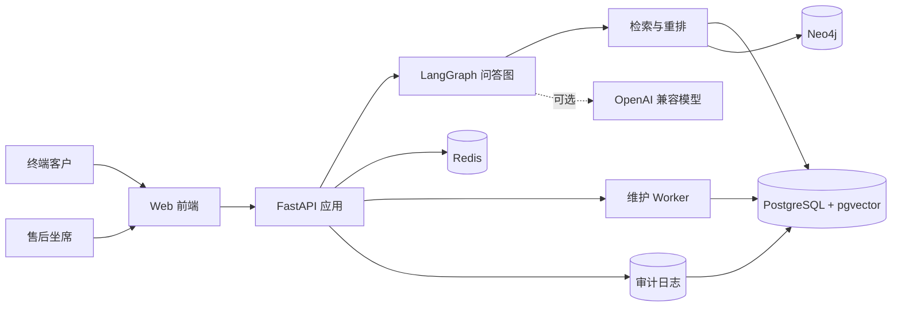
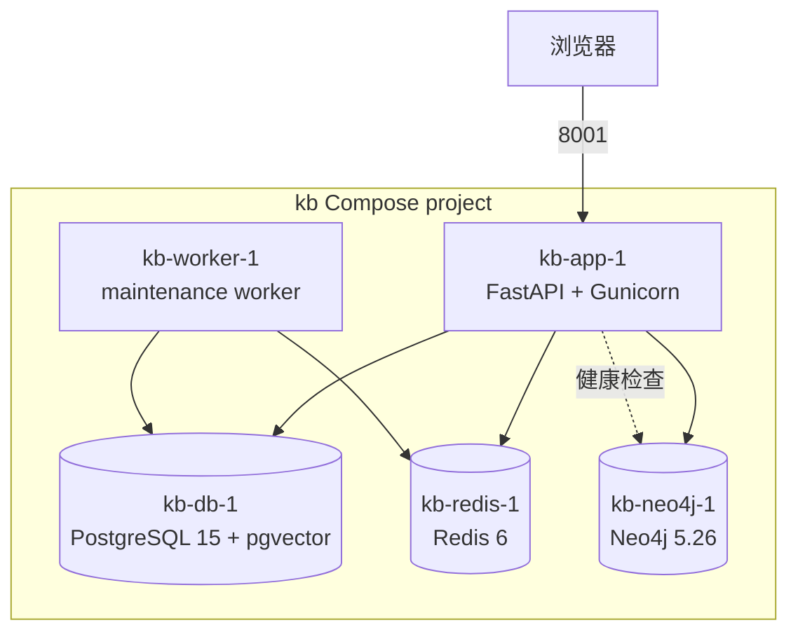
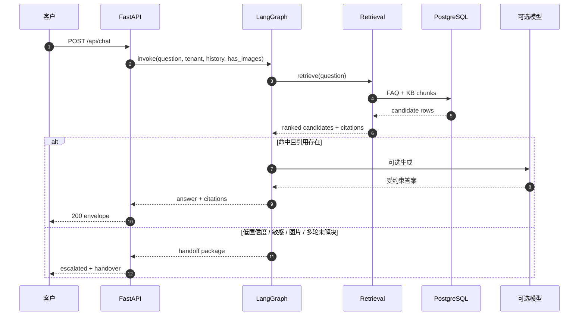
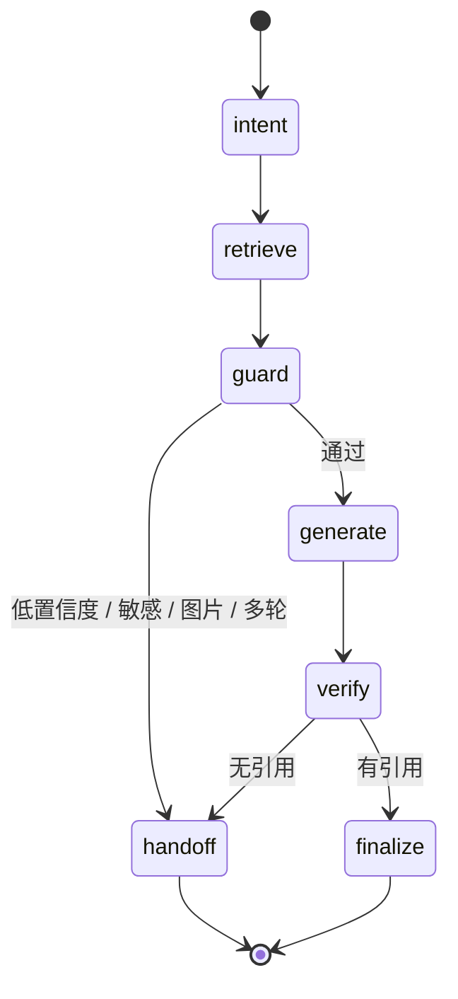

# 系统架构

## 1. 设计目标

设备售后知识问答系统面向“客户自助问答 + 坐席人工接管”的混合服务场景。设计目标按优先级排列：

1. **回答可追溯**：每个有效答案必须携带文档、页码和章节引用。
2. **不确定就转人工**：检索分数低、敏感意图、图片消息、客户主动要求或多轮未解决时，进入人工队列。
3. **交接不丢上下文**：转人工时生成摘要、已收集信息、AI 建议和推荐知识 Top3。
4. **本机可部署**：通过 Docker Compose 启动完整五服务，而不是只能运行单个脚本。
5. **可回归、可复现**：评测集、检索基准、DoD 和异常场景都能重复执行。

## 2. 系统上下文



系统不替换企业原有 ERP / OA，而是作为售后知识层和交接层存在：上游可以对接工单系统，下游可以对接坐席工作台。

## 3. 容器拓扑



| 服务 | 作用 | 默认端口 | 数据持久化 |
|---|---|---|---|
| `app` | API、静态前端、问答编排 | 8001 | 无状态 |
| `worker` | 心跳超时回队列、30 分钟归档、解析维护 | 无宿主端口 | 无状态 |
| `db` | 业务数据、FAQ、知识切片、pgvector | 容器内 5432 | `kb_pgdata` |
| `redis` | 缓存、幂等、限流、锁 | 容器内 6379 | `kb_redis` |
| `neo4j` | 图数据库接入与健康检查 | 7474 / 7687 | `kb_neo4j` |

本机默认只绑定 `127.0.0.1`，避免把演示服务暴露到局域网。生产环境通过反向代理暴露 8001。

## 4. 问答请求时序



## 5. LangGraph 状态机



| 节点 | 职责 | 关键输入 | 关键输出 |
|---|---|---|---|
| `intent` | 标记图片、转人工请求、敏感意图或普通问答 | 问题、图片标记 | `intent_label` |
| `retrieve` | 执行 FAQ、BM25、哈希向量召回 | 问题、租户 | `candidates`、`confidence` |
| `guard` | 判断低置信度、敏感、图片、多轮未解决 | 候选分数、历史 | `escalate`、`reason` |
| `generate` | FAQ 直出或模型/检索式生成 | 候选证据 | `answer` |
| `verify` | 检查答案与引用是否存在 | 答案、引用 | `escalate`、`reason` |
| `handoff` | 生成人工交接包并结束 | 会话、候选 | 交接包 |
| `finalize` | 返回带引用答案 | 答案、引用 | 最终结果 |

代码入口：`app/services/answer.py`；状态图由 `StateGraph(AnswerState)` 编译，条件边控制 `guard -> handoff/generate` 与 `verify -> handoff/finalize`。

## 6. 检索与重排

### 6.1 当前链路

```text
原始问题
  -> 型号规范化（NC500 -> NC-500）
  -> 口语术语扩展（老趴窝 -> 设备停机）
  -> FAQ 精确匹配 + FAQ BM25
  -> KB chunk BM25 + 384 维哈希向量
  -> 规则重排（保修 / 故障处理 / 通用章节降权）
  -> 候选证据 + 文档 / 页码 / 章节引用
```

### 6.2 设计取舍

- **先用可复现 baseline**：当前使用确定性哈希向量，不依赖外部 embedding 服务，保证离线可运行。
- **FAQ 优先**：标准售后政策问题用 FAQ 直出，避免模型自由发挥。
- **规则重排**：对保修、故障处理、通用故障码目录做可解释重排，便于定位回归。
- **模型可选**：配置 `MODEL_BASE_URL` / `MODEL_API_KEY` 时调用 OpenAI 兼容接口；未配置时使用检索式降级。
- **未完成的增强**：bge embedding、bge-reranker、RAGAS、Langfuse、OCR 和 Neo4j 图谱写入仍在路线图中，不在当前已实现范围内。

### 6.3 评测结果

| 集合 | Top-1 | Top-3 | MRR |
|---|---:|---:|---:|
| 标准 120 条 | 100% | 100% | 1.0 |
| 构造压力集：基线 | 45.8%（55/120） | 60.0%（72/120） | 0.5069 |
| 构造压力集：最终 | 100%（120/120） | 100%（120/120） | 1.0 |

压力集对型号连字符和口语表达做替换，属于构造测试，不代表线上真实流量。详见[评测说明](EVALUATION.md)。

## 7. 数据模型

| 实体 | 作用 | 关键字段 |
|---|---|---|
| `Tenant` | 租户隔离 | `id`、`code`、`name` |
| `User` | 管理员 / 坐席 | `tenant_id`、`role`、`staff_role`、`password_hash` |
| `ChatSession` | 会话状态与队列 | `status`、`assigned_agent_id`、`handover`、`queue_entered_at` |
| `Message` | 消息与引用 | `role`、`content`、`citations` |
| `KbDoc` | 知识文档 | `name`、`model`、`parse_status`、`version` |
| `KbChunk` | 可检索切片 | `page_no`、`section_path`、`text`、`embedding` |
| `Faq` | 标准问答 | `question`、`answer`、`source_doc`、`source_page` |
| `UnmatchedQuestion` | 未命中池 | `question`、`count`、`status` |
| `Ticket` | 历史工单 | `ticket_id`、`fault_code`、`description`、`resolution` |
| `AuditLog` | 审计 | `trace_id`、`action`、`actor`、`object_type` |

所有业务表通过 `tenant_id` 做租户隔离；管理接口在路由层做角色校验。

## 8. 可靠性与安全

- 健康检查同时探测 PostgreSQL、Redis、Neo4j。
- Redis 幂等键防止同一 `message_id` 重复处理。
- 限流默认 20 次/分钟；单坐席并发默认 5。
- 重复接管返回 409；Redis 不可用时降级为进程内缓存。
- 维护 worker 负责心跳超时回队列和 30 分钟无消息归档。
- 密码使用 Argon2id；所有管理写操作写审计日志。
- `.env` / `.env.prod` 不进入镜像和版本库；生产使用独立密钥。

## 9. 部署与扩展路径

当前部署是单机 Docker Compose，适合演示、验收和单机试点。扩展到生产时建议：

1. 接入真实 OpenAI 兼容模型或私有模型网关。
2. 将哈希向量替换为 bge/兼容 embedding，并加入 reranker。
3. 接入 RAGAS / Langfuse 做离线评测和链路观测。
4. 完成 Neo4j 图谱写入与多跳查询。
5. 接入 OCR / 视觉模型处理图像型 PDF 和报警截图。
6. 增加反向代理、TLS、集中日志、监控告警和 PostgreSQL/Neo4j 备份。

生产前检查清单见[DEPLOYMENT.md](DEPLOYMENT.md)与根目录[SECURITY.md](../SECURITY.md)。
