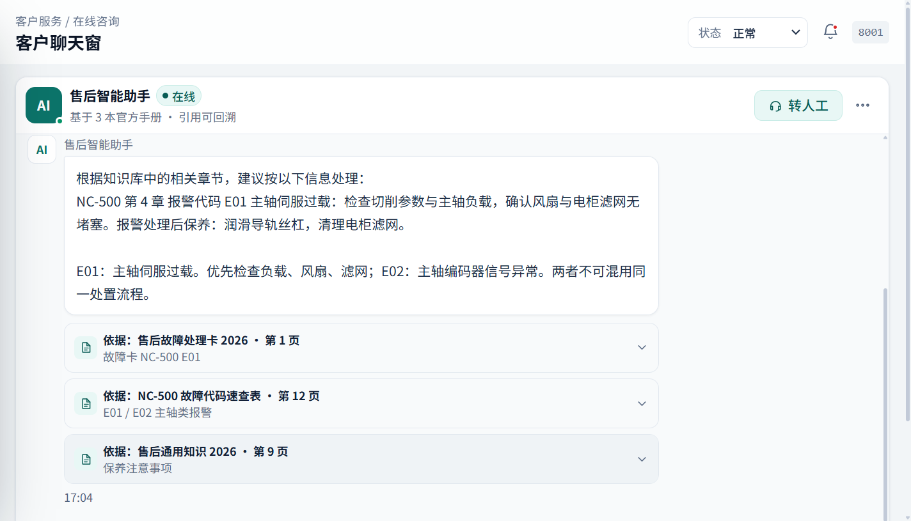
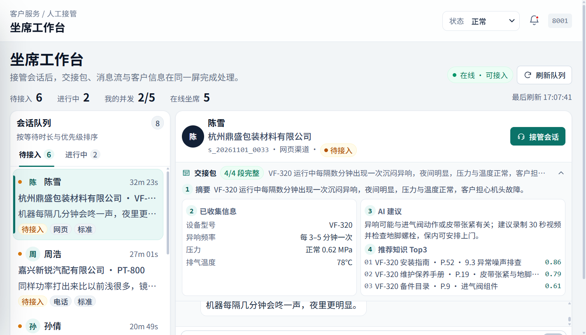
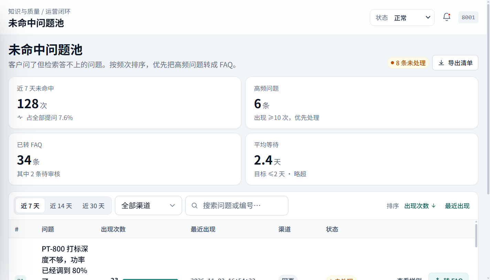
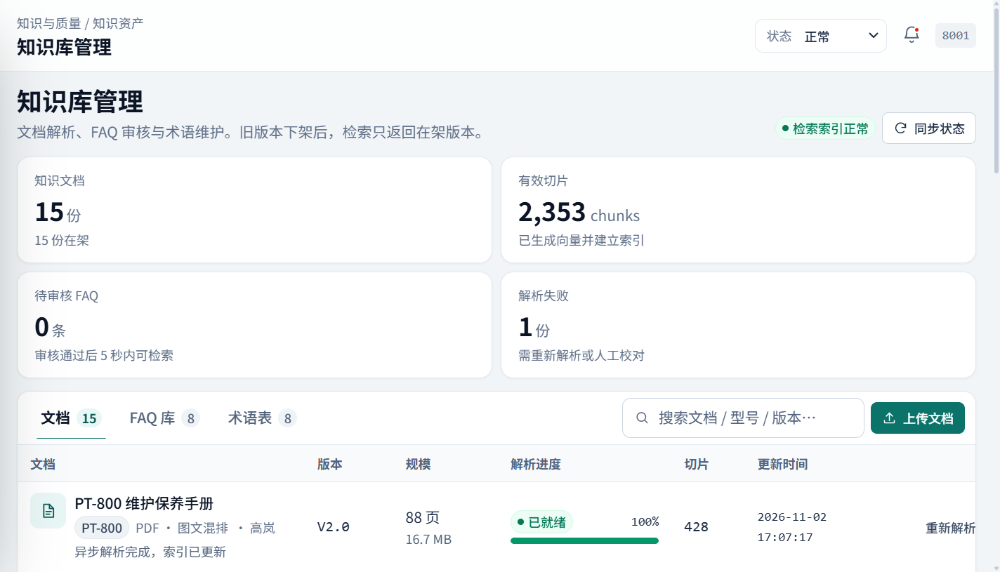
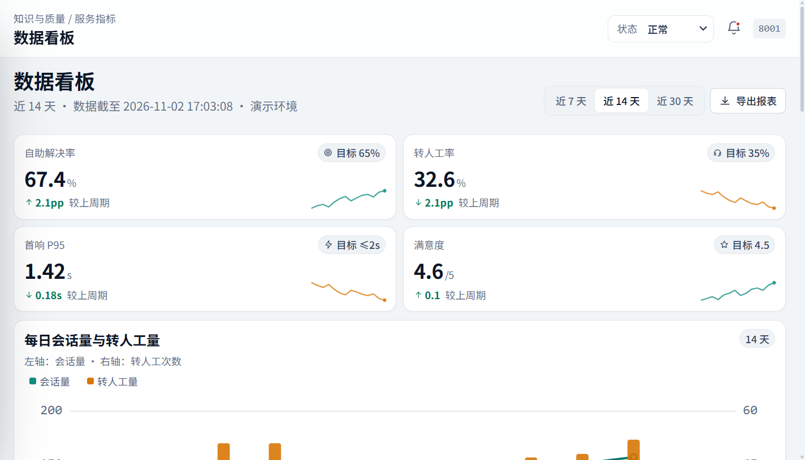
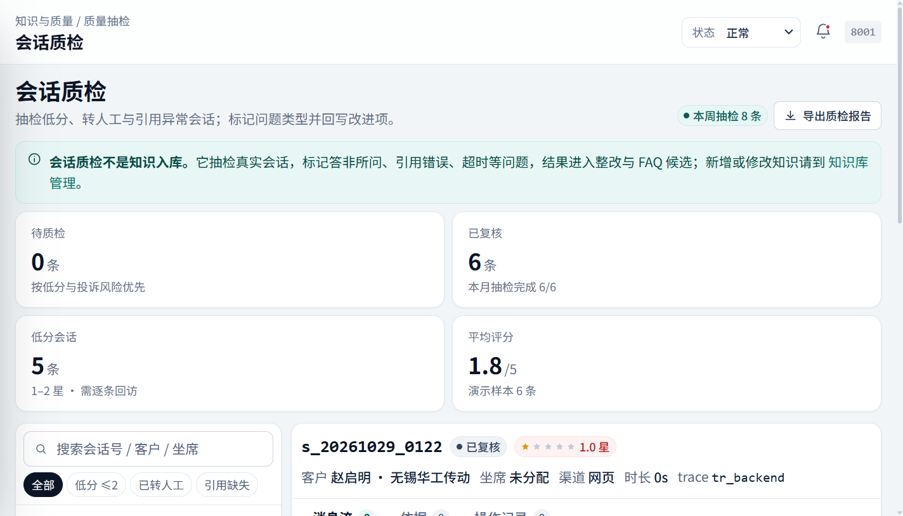
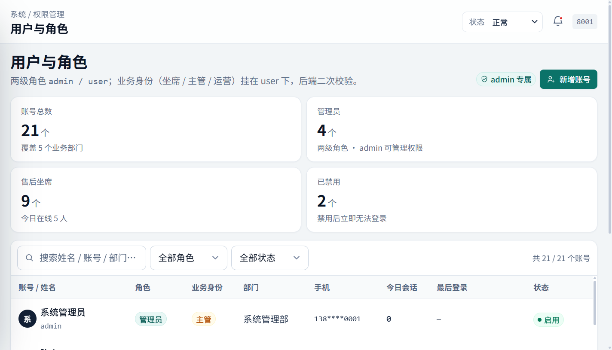

# 界面截图

以下截图来自当前本地 Docker 版本的 `http://127.0.0.1:8001`，视口约 1424x815。页面中的人名、公司、工单和指标均为构造演示数据。

## 1. 客服聊天与手册引用

客户提问后，系统给出处理步骤，并在回答下方列出文档、页码和章节。低置信度或敏感问题会进入转人工分支。

## 2. 坐席工作台与交接包

工作台同时展示待接入队列、进行中会话、客户信息、会话摘要、已收集信息、AI 建议和推荐知识 Top3。坐席可直接接管并回复。

## 3. 未命中问题池

按出现频次聚合未命中问题，支持按渠道、时间和状态筛选，并转为 FAQ 草稿。

## 4. 知识库管理

展示文档、有效切片、解析状态、版本和 FAQ/术语入口。文档解析失败会进入待处理队列。

## 5. 服务指标看板

展示自助解决率、转人工率、首响 P95、满意度、会话趋势和待处理提醒。看板当前使用演示数据。

## 6. 会话质检

对低分、转人工和引用异常会话进行抽检，记录问题类型和改进项。

## 7. 用户与角色

管理员可管理用户、坐席角色和状态。生产环境必须替换默认管理员密码并接入正式身份体系。
